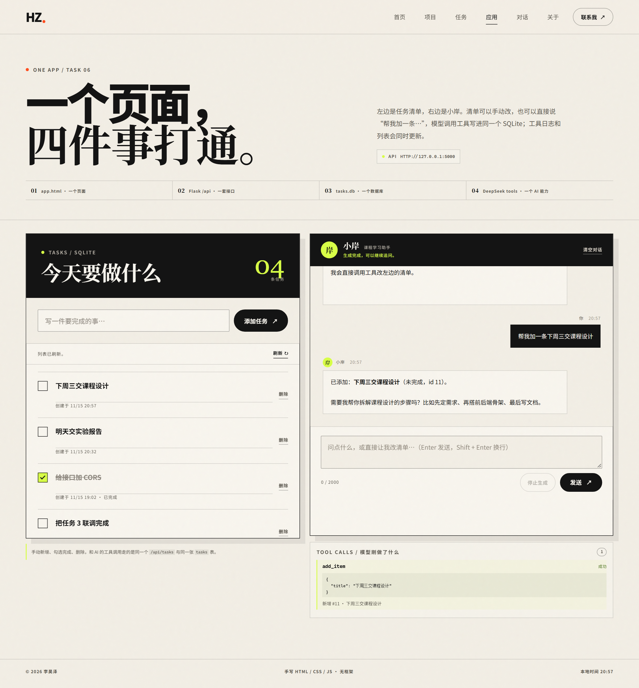

# 一个页面，四件事打通

一个把「任务清单」和「AI 助手」放在同一页的课程整合项目：左边手动增删改查，右边用自然语言让模型调用工具改同一张表。

- **在线应用**：<https://lihaoze-star.github.io/web-phase4-lihaoze/app.html>
- **任务页（单独看 CRUD）**：<https://lihaoze-star.github.io/web-phase4-lihaoze/tasks.html>
- **对话页（单独看流式）**：<https://lihaoze-star.github.io/web-phase4-lihaoze/chat.html>
- **前端仓库**：<https://github.com/lihaoze-star/web-phase4-lihaoze>
- **API 仓库**：<https://github.com/lihaoze-star/web-phase4-api-lihaoze>
- **2 分钟演示**：<https://lihaoze-star.github.io/web-phase4-lihaoze/docs/demo.mp4>
- **演示封面**：<https://lihaoze-star.github.io/web-phase4-lihaoze/docs/screenshots/demo-poster.png>



## 解决什么问题

前五个任务分别是个人主页、CRUD API、前后端联调、流式对话、工具调用。这个任务把它们合成一个能用的应用：

- 一个页面 `app.html`：任务清单 + AI 助手，同一屏。
- 一套接口：Flask 的 `/api/tasks` 和 `/api/chat`，同一个服务。
- 一个数据库：`tasks.db` 的 `tasks` 表，手动操作和 AI 工具调用都写它。
- 一个 AI 能力：DeepSeek 流式回答 + `add_item` / `query_items` 工具调用。

不是把五个作业并排放在导航里：在对话里说「帮我加一条准备 2 分钟演示」，左边清单会自动从 04 变成 05，工具日志同时出现 `add_item` 的参数与结果。

## 功能

### 任务 CRUD

- 加载中 / 空数据 / 请求失败三态，失败可重试。
- 新增、勾选完成、删除，全部走真实 `fetch`。
- 刷新页面数据仍在；SQLite 持久化。
- 统一 JSON 信封：`{ code, data, msg }`。

### AI 流式对话

- 后端代理 DeepSeek，Key 只在服务端 `.env`。
- SSE 逐字输出，前端 `ReadableStream` 读取。
- 三轮上下文，服务端 `MAX_CONTEXT_CHARS=6000` 截断。
- 停止生成、重试、清空、可读的超时/401/429/余额错误。

### 工具调用

- `add_item`：新增任务，执行 `INSERT INTO tasks`。
- `query_items`：按状态/关键词查询，执行 `SELECT`。
- 模型返回 `tool_calls` → 后端执行 SQLite → 结果以 `role=tool` 回填 → 模型自然语言总结。
- 工具结果以 SSE `{"tool_call":...}` 推给前端；右侧日志显示工具名、参数、成功/失败、结果摘要。
- 工具调用后同一页的任务列表自动刷新。
- 工具循环最多 3 轮，防死循环。

## 技术栈

| 层 | 选型 | 为什么 |
| --- | --- | --- |
| 前端 | 原生 HTML / CSS / JavaScript | 0 框架、0 构建，代码可直接读；课程要求 |
| 后端 | Python 3.12 + Flask | 单文件应用，路由/校验/CORS 都清楚 |
| 数据库 | SQLite (`tasks.db`) | 单用户课程项目，零配置、文件持久化、支持 SQL 查询 |
| AI | DeepSeek `deepseek-chat` | OpenAI 兼容接口，支持 SSE 与 function calling |
| 部署 | GitHub Pages + Cloudflare Quick Tunnel | 前端静态托管；本地 API 用临时公网地址 |
| 测试 | Python `unittest` | 32 个后端测试，含工具参数校验 |

## 架构

```text
app.html
  ├─ GET/POST/PUT/DELETE /api/tasks ──┐
  └─ POST /api/chat (SSE)             │
        └─ DeepSeek stream + tools    │
              └─ execute_tool ────────┤
                                      ▼
                              data/tasks.db
```

- `app.html` 同时加载 `js/tasks.js` 与 `js/chat.js`。
- 两个模块共用一个 `js/config.js` 的 `baseUrl`。
- 工具执行成功后，`chat.js` 派发 `tasks:changed` 事件，`tasks.js` 重新 `GET /api/tasks`，所以列表会自己刷新。

## 本地运行（约 10 分钟）

> **Windows 一键启动**：确认 `web-phase4-api-lihaoze` 和 `web-phase4-lihaoze` 在同一个目录、API 的 `.venv` 已创建后，双击根目录的 `start-local.bat`，会同时启动 API 和前端并打开 `app.html`。

### 1. 准备

- Python 3.10+（开发环境 3.12）
- 一个 DeepSeek API Key（只用于 AI 部分；不填也能跑 CRUD）

### 2. 启动 API

```powershell
git clone https://github.com/lihaoze-star/web-phase4-api-lihaoze.git
cd web-phase4-api-lihaoze

python -m venv .venv
.venv\Scripts\activate

pip install -r requirements.txt

Copy-Item .env.example .env
notepad .env
```

把 `.env` 填成：

```env
LLM_PROVIDER=deepseek
LLM_MODEL=deepseek-chat
LLM_API_KEY=sk-你的Key
MAX_CONTEXT_CHARS=6000
```

启动：

```powershell
python app.py
```

默认监听 <http://127.0.0.1:5000>。

### 3. 启动前端

另开一个终端：

```powershell
git clone https://github.com/lihaoze-star/web-phase4-lihaoze.git
cd web-phase4-lihaoze

python serve.py --port 8000
```

打开 <http://127.0.0.1:8000/app.html>。

> 不要直接双击 HTML。`file://` 下 `fetch` 会被拦截，应该用 `serve.py` 或 `python -m http.server 8000`。

### 4. 验证

1. 在左边输入「整理答辩提纲」，点添加 → 数据库多一条。
2. 在右边说「帮我加一条准备 2 分钟演示」→ 工具日志出现 `add_item`，左边自动多一条。
3. 在右边说「查一下有哪些未完成的任务」→ 工具日志出现 `query_items`，回答列出任务。
4. 刷新页面 → 数据仍在。

## 环境变量

| 变量 | 必填 | 说明 |
| --- | --- | --- |
| `LLM_PROVIDER` | 否 | `deepseek` / `zhipu` / `bailian` / `doubao`，默认 `deepseek` |
| `LLM_MODEL` | 否 | 默认 `deepseek-chat`；豆包填接入点 ID |
| `LLM_API_KEY` | AI 必填 | 只放服务端 `.env`，不要写进前端 |
| `MAX_CONTEXT_CHARS` | 否 | 默认 `6000` |
| `LLM_BASE_URL` | 否 | 覆盖默认接口地址，一般不用 |

`.env` 已被 `.gitignore` 忽略；仓库里只有 `.env.example`。Key 卫生证明见 [docs/task4.md](docs/task4.md) 与 [docs/screenshots/env-proof.png](docs/screenshots/env-proof.png)。

## 接口

| 方法 | 路径 | 作用 |
| --- | --- | --- |
| GET | `/api/tasks` | 任务列表 |
| POST | `/api/tasks` | 新增任务，body `{ "title": "..." }` |
| GET | `/api/tasks/:id` | 单条任务 |
| PUT | `/api/tasks/:id` | 修改标题/完成状态 |
| DELETE | `/api/tasks/:id` | 删除 |
| POST | `/api/chat` | 流式对话 + 工具调用，SSE |

普通接口统一返回：

```json
{ "code": 200, "data": {}, "msg": "ok" }
```

聊天接口返回 SSE：

```text
data: {"delta":"已"}

data: {"tool_call":{"name":"add_item","arguments":{"title":"..."},"result":{"ok":true,"item":{...}}}}

data: {"done":true}
```

## 数据结构

```sql
CREATE TABLE IF NOT EXISTS tasks (
  id INTEGER PRIMARY KEY AUTOINCREMENT,
  title TEXT NOT NULL,
  done INTEGER NOT NULL DEFAULT 0,
  created_at TEXT NOT NULL
);
```

为什么就一张表：

- 单用户、单清单，没有多租户/权限需求。
- `done` 用 0/1 存布尔，SQLite 没有原生 bool，过滤直接 `done = 0/1`。
- `created_at` 存 ISO 时间字符串，前端直接 `new Date()` 格式化，排序不依赖时区。
- 工具和 CRUD 共用一张表，避免「AI 改一份、页面改另一份」的双写问题。

## 目录结构

```text
web-phase4-lihaoze/                 # 前端（GitHub Pages）
├── app.html                        # 任务 6 整合页：任务 + AI + 工具日志
├── tasks.html                      # 单独的任务 CRUD 页
├── chat.html                       # 单独的流式对话页
├── index.html / project.html / 404.html
├── css/
│   ├── style.css                   # 全站样式
│   ├── tasks.css                   # 任务面板
│   ├── chat.css                    # 对话面板
│   └── app.css                     # 整合页布局
├── js/
│   ├── config.js                   # API baseUrl（本地/线上自动切换）
│   ├── tasks.js                    # CRUD + 三态
│   ├── chat.js                     # SSE、停止、工具日志
│   └── main.js / project.js        # 主页/项目页交互
├── docs/
│   ├── demo.mp4                    # 2 分钟演示
│   ├── task3.md / task4.md / task5.md
│   └── screenshots/                # 功能与验收截图
└── serve.py                        # 本地静态服务器（支持 404）

web-phase4-api-lihaoze/             # 后端（Flask）
├── app.py                          # 路由、校验、CORS、SQLite、SSE、tools
├── data/tasks.db                   # 运行时数据库（gitignore）
├── tests/test_api.py               # 32 个 unittest
├── requirements.txt
├── .env.example                    # 环境变量模板
├── Procfile / render.yaml          # Render 部署
└── docs/api.md                     # 接口文档
```

## 设计取舍

- **为什么不用框架**：课程目标是理解 fetch、SSE、DOM 和状态；原生代码让每一段都能在答辩时讲清。代价是复用少，所以 CSS/JS 按页面拆文件。
- **为什么是 SQLite**：单用户、数据量小、要真实持久化。SQLite 零配置，工具与 CRUD 共用一张表，事务简单；多用户高并发不适合它。
- **为什么用 SSE 而不是 WebSocket**：只需要服务端单向推 token，SSE 基于 HTTP，浏览器 `ReadableStream` 直接读，部署和调试更简单。
- **为什么工具在后端执行**：Key 和数据库都不暴露给浏览器；模型只返回结构化 `tool_calls`，Flask 做参数校验和 SQL。
- **为什么工具循环最多 3 轮**：防止模型反复调用/死循环；正常一次工具调用后就能总结，3 轮足够兜底。

## 已知问题

1. **公网 API 是临时隧道**：当前用 Cloudflare Quick Tunnel，进程必须保持运行；重启后 URL 会变，要同步改 `js/config.js` 的 `baseUrl`。长期部署用 `render.yaml` 到 Render，补 `LLM_API_KEY`。
2. **没有登录/鉴权**：这是单用户课程项目，任何拿到 API 地址的人都能写任务；不要直接当生产服务暴露。
3. **聊天历史只在内存**：刷新页面会清空对话与工具日志；任务数据在 SQLite，不受影响。
4. **模型延迟不可控**：长回答可能超过 60 秒；已做 60 秒超时、停止按钮和中文错误提示，但没有断点续传。
5. **工具能力有限**：只有新增和查询，没有删除/修改工具；复杂多步任务需要模型多次调用，超过 3 轮会停止。
6. **SQLite 单写入者**：课程规模够用，高并发写入会锁等待。
7. **部分免费隧道会缓冲 SSE**：已加 `Cache-Control: no-transform` 与 `X-Accel-Buffering: no`；Cloudflare 隧道下实测正常。

## 2 分钟演示

[](https://lihaoze-star.github.io/web-phase4-lihaoze/docs/demo.mp4)

结构：问题背景 → 手动 CRUD → 自然语言工具调用 → 工具日志/列表自动刷新 → 技术栈 → 踩过的坑。

- <https://lihaoze-star.github.io/web-phase4-lihaoze/docs/demo.mp4>（约 2 分钟，1280×800）
- [docs/task5.md](docs/task5.md)：工具调用完整链路与失败案例
- [docs/task4.md](docs/task4.md)：流式、上下文、Key 证明
- [docs/task3.md](docs/task3.md)：前后端联调与三态

## 答辩速记

**1. 为什么这样设计？**

单用户课程项目优先「能跑、能讲清、能维护」：原生前端降低抽象；Flask 单文件让路由/校验/CORS 一眼可见；SQLite 省掉数据库服务；SSE 比 WebSocket 更贴合单向 token 流；工具在后端执行保证 Key 和数据库不出浏览器。

**2. 打开一个文件讲代码。**

看 `js/chat.js` 的 `parseBlock()`：它按 `\n\n` 切 SSE 事件，逐行取 `data:`，`JSON.parse` 后处理三种 payload：`delta` 追加文字、`tool_call` 写工具日志并派发 `tasks:changed`、`error` 抛给统一错误 UI。`done` 返回 true 结束读取。

后端看 `app.py` 的 `stream_model_turn()`：流式累积 `delta.content` 和 `delta.tool_calls`，`normalise_tool_calls()` 拼完整参数，`execute_tool()` 执行 SQLite，结果以 `role=tool` 回填后再请求模型。

**3. 哪里最容易坏？**

公网隧道和模型额度。开发中真实踩过：localhost.run 的 OPTIONS 预检被边缘丢弃，页面只报 `Failed to fetch`；用 CDP Network 看到预检没有 `Access-Control-Allow-Origin`，换 Cloudflare Quick Tunnel 后恢复。另一个是工具参数名 `content`/`title` 不一致，模型按 schema 传 `content`，后端返回「title 必须是字符串」；修法是统一字段名、description 给示例、后端保留校验，并用同一句话重测。

## 测试

```powershell
cd web-phase4-api-lihaoze
.venv\Scripts\python.exe -m unittest discover -s tests -v
```

当前 **32 个测试全部通过**：CRUD、校验、CORS、聊天参数、SSE mock、上下文截断、401/429/超时、工具写库/查询/参数错误。

## 页面地图

| 页面 | 作用 |
| --- | --- |
| `app.html` | 任务 6 整合页：任务清单 + AI + 工具日志 |
| `tasks.html` | 单独的任务 CRUD 联调页 |
| `chat.html` | 单独的流式对话 + 工具页 |
| `index.html` | 个人主页 |
| `project.html` | 项目档案与专注计时器 |
| `404.html` | 自定义 404 |

---

手写 HTML / CSS / JS，无框架、无构建步骤。李昊泽 · 2026。
