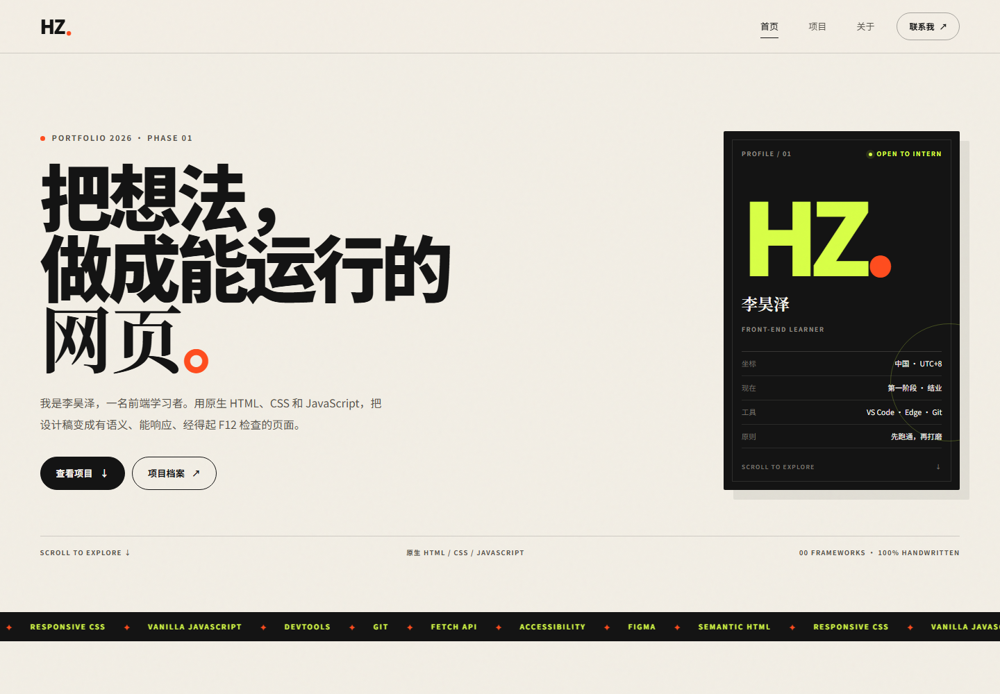
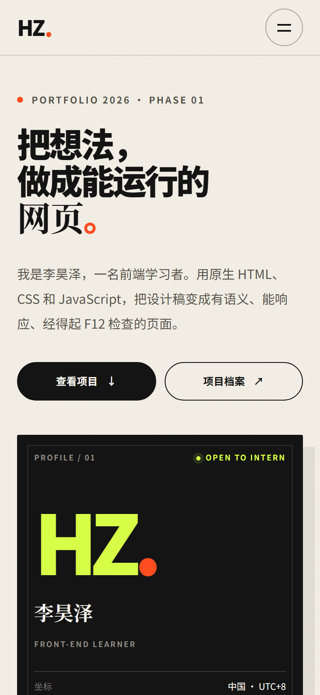
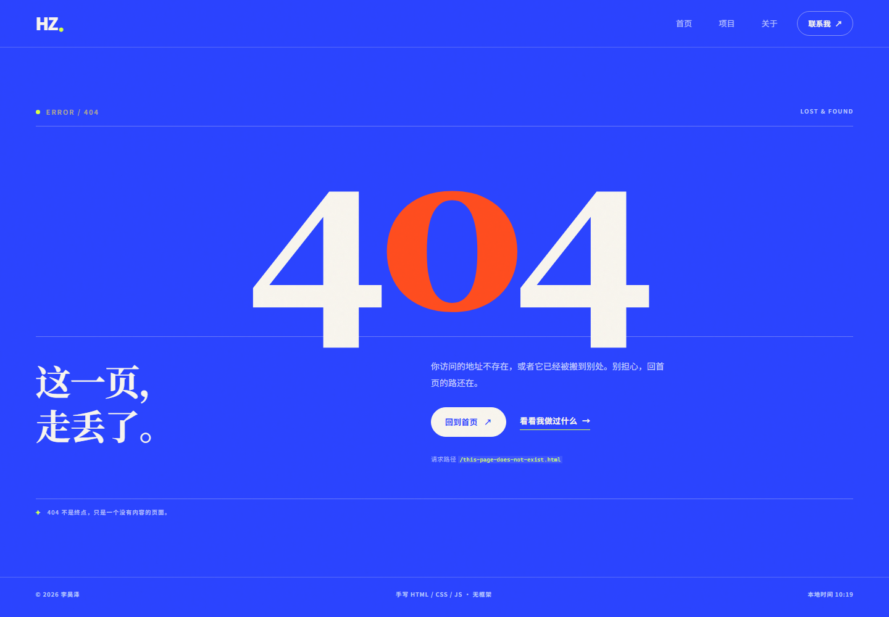
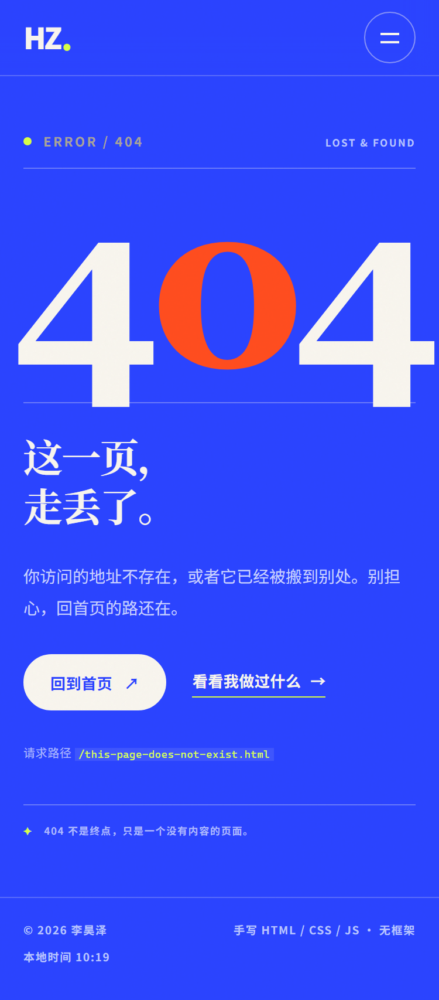
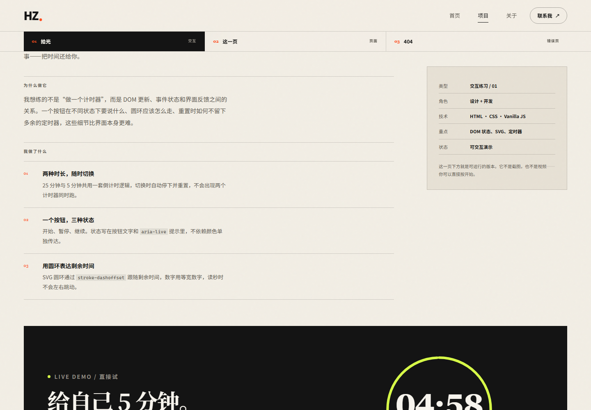

# web-phase4-lihaoze · 第一阶段作品集

用原生 **HTML / CSS / JavaScript** 完成的第一阶段作业：一个个人主页、一页项目档案，以及一个认真设计的 404。

没有框架、没有构建步骤、没有 npm 依赖，所有页面都可以直接阅读源代码。

- **选题**：任务 1 · 选题一「个人主页」（含项目展示页与 404）
- **仓库**：<https://github.com/lihaoze-star/web-phase4-lihaoze>
- **线上地址**：部署后填写，步骤见下方「部署到 GitHub Pages」
- **技术限制**：0 框架 / 0 构建 / 0 依赖，仅原生 HTML、CSS、JavaScript

---

## 预览

### 电脑端 · 1440px



[查看首页完整长图](docs/screenshots/desktop-home.png) · [查看项目档案完整长图](docs/screenshots/desktop-project.png)

### 手机端 · 375px



[查看首页完整长图](docs/screenshots/mobile-home.png) · [查看项目档案完整长图](docs/screenshots/mobile-project.png) · [手机端菜单](docs/screenshots/mobile-menu.png)

### 404 与交互

| 404（电脑端） | 404（手机端） |
| --- | --- |
|  |  |



---

## 页面与交互

| 页面 | 内容 | 交互 |
| --- | --- | --- |
| `index.html` | 自我介绍、技能栈、第一阶段项目卡片、联系方式 | 项目筛选、移动端菜单、`fetch` 更新「现在」卡片 |
| `project.html` | 三个项目的简介、封面、拆解与复盘 | 吸顶项目目录（`IntersectionObserver`）、可运行的 25/5 分钟专注计时器 |
| `404.html` | 自定义错误页，显示请求路径并给出回首页入口 | 读取 `location.pathname` 显示走丢的地址 |

四个 JS 交互都不依赖 CSS `:hover`：

1. **项目筛选**：`index.html` 的三个筛选按钮，按 `data-category` 过滤卡片，并更新可见数量。
2. **移动端菜单**：`aria-expanded`、焦点管理、Esc 关闭、Tab 焦点循环。
3. **专注计时器**：开始 / 暂停 / 继续 / 重置、25 与 5 分钟切换、SVG 圆环进度。
4. **一次真实的 `fetch`**：「现在」卡片从 `data/now.json` 读取内容，失败时保留静态回退，不产生控制台报错。

---

## 本地打开

需要 Python 3（不需要安装任何依赖）：

```bash
cd web-phase4-lihaoze
python serve.py
```

然后打开 <http://127.0.0.1:8000/>。

> 不建议直接双击 `index.html`。`file://` 下浏览器会拦截 `fetch("data/now.json")`，自定义 404 也不会生效。
> 如果只想看页面，`python -m http.server 8000` 也可以，但它不会返回自定义 404 页。

---

## 目录结构

```text
web-phase4-lihaoze/
├── index.html               # 个人主页
├── project.html             # 项目档案
├── 404.html                 # 自定义错误页
├── css/
│   └── style.css            # 全部样式与响应式断点
├── js/
│   ├── main.js              # 菜单、筛选、fetch、时钟
│   └── project.js           # 吸顶目录、专注计时器
├── data/
│   └── now.json             # 首页「现在」卡片的数据源
├── assets/
│   ├── favicon.svg
│   └── img/                 # 压缩后的 WebP 封面（单张 < 300 KB）
├── docs/
│   ├── network-record.md    # 抓包记录（3 条核心请求 + 404）
│   ├── network-capture.json # 原始网络事件
│   └── screenshots/         # 电脑端 / 手机端截图
├── scripts/
│   ├── capture.mjs          # 可选：用 CDP 重新生成截图与抓包记录
│   └── make_images.py       # 可选：生成项目封面
├── serve.py                 # 本地静态服务器（带自定义 404）
└── README.md
```

---

## 作业要求对照

| 要求 | 实现 | 证据 |
| --- | --- | --- |
| 至少 2 个页面，能互相跳转 | 3 个 HTML 页面，导航、项目卡片、页脚互链 | `index.html` ↔ `project.html` ↔ `404.html` |
| 使用语义化标签 | `header`、`nav`、`main`、`section`、`article`、`footer`，没有满屏 `div` | 查看任一 HTML 源码 |
| 375px 不出现横向滚动条、文字不重叠 | 三页在 375px 下 `scrollWidth === innerWidth`；移动端标题单独放宽行高 | [手机端截图](docs/screenshots/mobile-home.png) · 自测记录见下 |
| 至少 1 处 JS 交互，不能只靠 `:hover` | 筛选、菜单、计时器、`fetch` 共 4 处 | 见「页面与交互」 |
| 图片压缩后上传，单张 ≤ 300 KB | 4 张 WebP：30.7 KB / 56.4 KB / 110.9 KB / 143.3 KB | `assets/img/` |
| 控制台不能有红色报错 | 正常页面 0 条；404 页只有一条**故意**请求的 404 资源提示 | 见「自测记录」 |
| 部署到 HTTPS 公网地址 | GitHub Pages（步骤见下） | 部署后填写 |
| 抓包记录 3 条 + 故意 404 | 主文档、CSS、JS、`fetch` + 一个 404 | [docs/network-record.md](docs/network-record.md) |

---

## 抓包记录（摘要）

一次本地实测（Edge 157，1440 × 1000，`http://127.0.0.1:8000`）：

| 请求 | 路径 | 方法 | 状态码 | 耗时 | 传输大小 |
| --- | --- | --- | --- | --- | --- |
| 页面主文档 | `/` | GET | 200 | 8 ms | 13.4 KB |
| 样式表 | `/css/style.css` | GET | 200 | 22 ms | 39.7 KB |
| 脚本 | `/js/main.js` | GET | 200 | 27 ms | 5.3 KB |
| 自己写的 `fetch` | `/data/now.json` | GET | 200 | 5 ms | 0.4 KB |
| 故意请求不存在的路径 | `/this-page-does-not-exist.html` | GET | **404** | 7 ms | 3.6 KB |

完整记录、复现步骤和原始事件见 [docs/network-record.md](docs/network-record.md)。

404 截图：[电脑端](docs/screenshots/404.png) · [手机端](docs/screenshots/404-mobile.png)。

---

## 部署到 GitHub Pages

仓库已经初始化为一个本地 Git 仓库并完成提交，只差一个远程地址。

1. 在 GitHub 新建公开仓库 `web-phase4-lihaoze`（不要勾选 README / .gitignore）。
2. 在项目目录执行：

   ```bash
   git remote add origin https://github.com/lihaoze-star/web-phase4-lihaoze.git
   git branch -M main
   git push -u origin main
   ```

3. 打开仓库的 **Settings → Pages**：
   - **Source** 选择 `Deploy from a branch`
   - **Branch** 选择 `main`，目录选择 `/ (root)`
   - 点击 **Save**
4. 等 1 分钟左右，访问：

   ```text
   https://lihaoze-star.github.io/web-phase4-lihaoze/
   ```

   把这个地址填回本文开头的「线上地址」。

> 三个页面都使用相对路径，所以部署在 `/web-phase4-lihaoze/` 这样的子路径下也能正常工作。
> GitHub Pages 会自动把仓库根目录的 `404.html` 用作自定义错误页。

### 其他平台（任选其一）

- **Vercel**：New Project → 导入该仓库 → Framework Preset 选 `Other` → Output Directory 留空 → Deploy。
- **Cloudflare Pages**：Connect to Git → 选择仓库 → Build command 留空 → Build output directory 填 `/` → Deploy。

---

## 自测记录

- 日期：2026-11-13
- 浏览器：Microsoft Edge 157（headless，CDP 采集）
- 视口：电脑端 1440 × 1000；手机端 375 × 812（DPR 2）

| 页面 | 375px `innerWidth` | 375px `scrollWidth` | 横向溢出元素 | 控制台红色报错 |
| --- | --- | --- | --- | --- |
| `/` | 375 | 375 | 0 | 0 |
| `/project.html` | 375 | 375 | 0 | 0 |
| `/this-page-does-not-exist.html` | 375 | 375 | 0 | 1 条（故意的 404 请求） |

- 图片：3 张，全部带 `alt`；WebP 单张最大 143.3 KB。
- 语义化标签：`header` / `nav` / `main` / `section` / `article` / `footer` 均已使用。
- 交互自测：筛选切换、菜单开合、计时器 5 分钟开始→暂停→重置均正常；`fetch` 成功后「现在」卡片内容被更新。

重新生成截图与抓包记录（可选，需要本机 Edge 与 Node 22+）：

```bash
# 终端 1：本地服务器
python serve.py

# 终端 2：启动带调试端口的 Edge
"C:\Program Files (x86)\Microsoft\Edge\Application\msedge.exe" ^
  --headless=new --remote-debugging-port=9222 ^
  --user-data-dir=.tmp-browser/capture about:blank

# 终端 3：采集
node scripts/capture.mjs
```

---

## 可以改的地方

- 姓名、简介、社交链接：`index.html`、`project.html`、`404.html` 中的「李昊泽」与 `https://github.com/lihaoze-star`。
- 「现在」卡片：修改 `data/now.json`，刷新页面即可看到变化。
- 主题色与字体：`css/style.css` 顶部的 `:root` 变量。
- 项目封面：替换 `assets/img/*.webp`，保持单张 ≤ 300 KB。

---

## 说明

- 本项目是第一阶段作业，页面内容为个人学习作品集。
- 404 演示入口在 `project.html` 的「亲自走丢一次」，它会打开一个真实返回 404 的地址。
- 截图与抓包数据由 `scripts/capture.mjs` 通过 Chrome DevTools Protocol 生成；`docs/network-capture.json` 保留了原始事件，方便核对。
