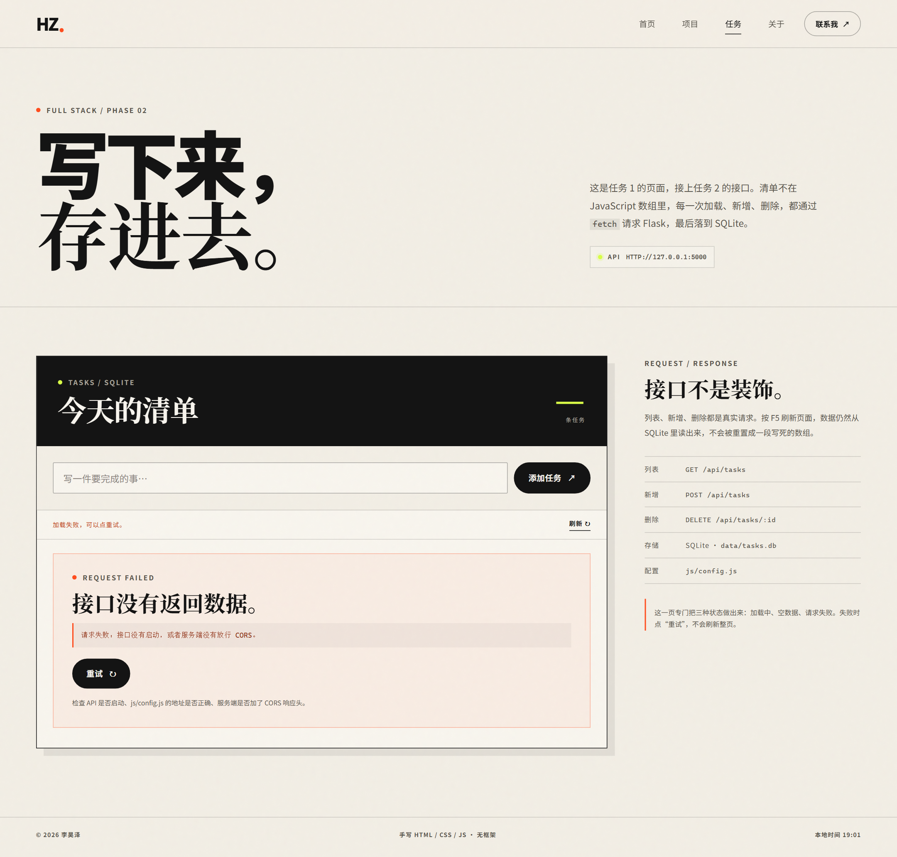
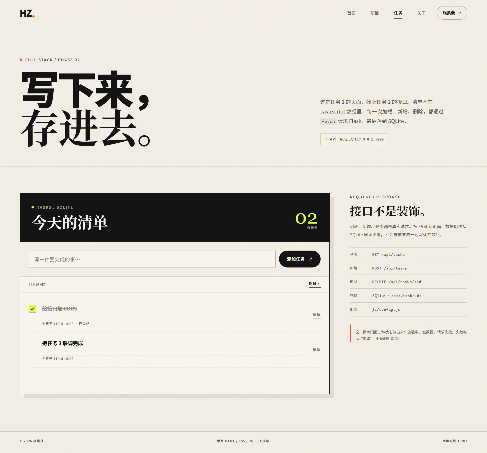

# 一次真实的 CORS 问题记录

任务 3 联调时，前端和 API 分别跑在两个端口，第一次请求就被浏览器拦住了。下面是原始报错、原因和修复过程。

## 环境

- 前端：`http://127.0.0.1:8000/tasks.html`（`python serve.py`）
- API：`http://127.0.0.1:5000/api/tasks`（Flask）
- 浏览器：Microsoft Edge，DevTools Console / Network

## 报错原文

Console：

```text
Access to fetch at 'http://127.0.0.1:5000/api/tasks' from origin 'http://127.0.0.1:8000' has been blocked by CORS policy: No 'Access-Control-Allow-Origin' header is present on the requested resource.
Failed to load resource: net::ERR_FAILED
```

Network 面板：

```text
Request URL: http://127.0.0.1:5000/api/tasks
Status: (failed) net::ERR_FAILED
corsErrorStatus: { corsError: "MissingAllowOriginHeader", failedParameter: "" }
```

页面表现：列表区域进入「请求失败」状态，显示错误原因和「重试」按钮。



## 原因

`127.0.0.1:8000` 和 `127.0.0.1:5000` 端口不同，属于**跨源请求**。浏览器允许请求发出去，但只有在响应里看到 `Access-Control-Allow-Origin` 时才把响应交给前端。

Flask 默认没有这个响应头，所以：

- 不是接口没启动：API 用 curl 直接请求是 200。
- 不是前端 `fetch` 写错：请求已经到达服务端。
- 不能靠改浏览器安全策略绕过。开发时用 `--disable-web-security` 只能骗自己，线上用户不会这样打开浏览器。

## 修复（服务端）

在 `app.py` 里加 `after_request`，给所有响应补 CORS 头：

```python
@app.after_request
def add_cors_headers(response):
    origin = request.headers.get("Origin")
    response.headers["Access-Control-Allow-Origin"] = origin or "*"
    response.headers["Vary"] = "Origin"
    response.headers["Access-Control-Allow-Methods"] = "GET, POST, PUT, DELETE, OPTIONS"
    response.headers["Access-Control-Allow-Headers"] = "Content-Type"
    response.headers["Access-Control-Max-Age"] = "86400"
    return response
```

`POST` 带 `Content-Type: application/json` 会先发 `OPTIONS` 预检；Flask 会自动响应 `OPTIONS`，上面的 `after_request` 也会给预检响应加上同样的头，所以预检能通过。

## 验证

直接看响应头：

```bash
curl -i -H "Origin: http://127.0.0.1:8000" http://127.0.0.1:5000/api/tasks
```

```text
HTTP/1.1 200 OK
Access-Control-Allow-Origin: http://127.0.0.1:8000
Vary: Origin
Access-Control-Allow-Methods: GET, POST, PUT, DELETE, OPTIONS
Access-Control-Allow-Headers: Content-Type
Access-Control-Max-Age: 86400
```

预检：

```bash
curl -i -X OPTIONS \
  -H "Origin: http://127.0.0.1:8000" \
  -H "Access-Control-Request-Method: POST" \
  -H "Access-Control-Request-Headers: content-type" \
  http://127.0.0.1:5000/api/tasks
```

返回 200，并带上同样的 `Access-Control-Allow-*` 头。

刷新页面后，列表正常读取，新增和删除也恢复：



## 线上验证

前端部署在 GitHub Pages，API 通过 HTTPS 隧道暴露；两个源不同，仍然走同一套 CORS 头。线上页面打开后能正常读取、添加、删除，说明 CORS 在真实跨域环境下生效。

## 结论

- CORS 要在**服务端**解决，不是前端加个 `mode: "no-cors"`，也不是改浏览器。
- `after_request` 同时覆盖正常响应、错误响应和预检响应，避免只修好 GET、POST 又挂掉。
- 本地联调和线上部署都要检查 `Origin` 与 `Access-Control-Allow-Origin` 是否匹配。
