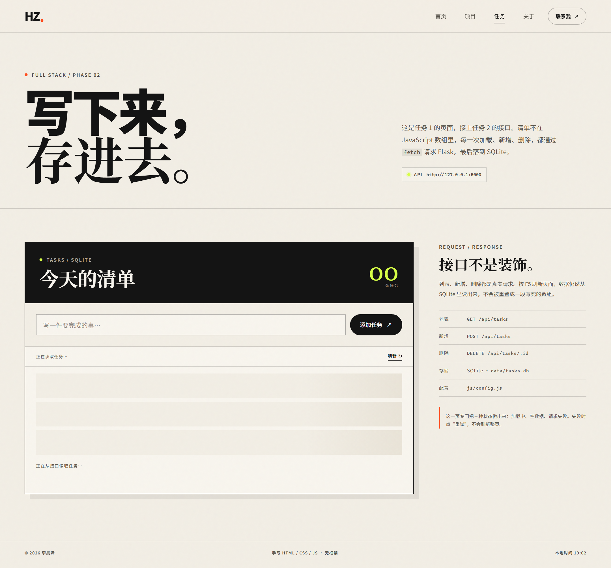
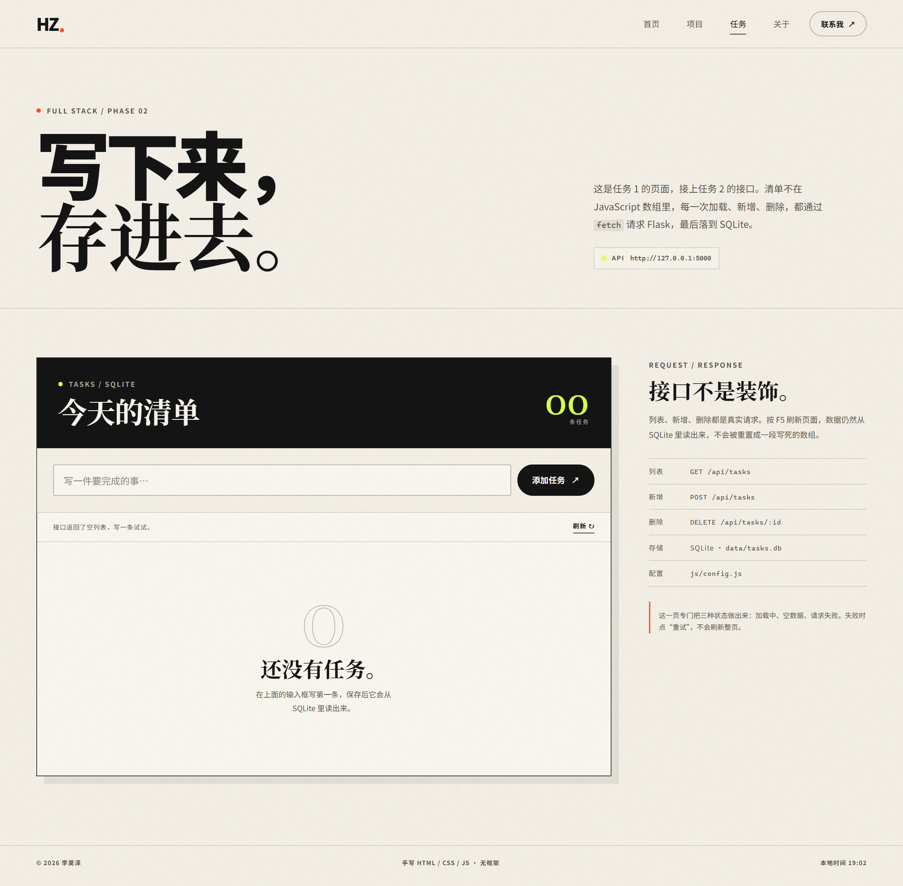
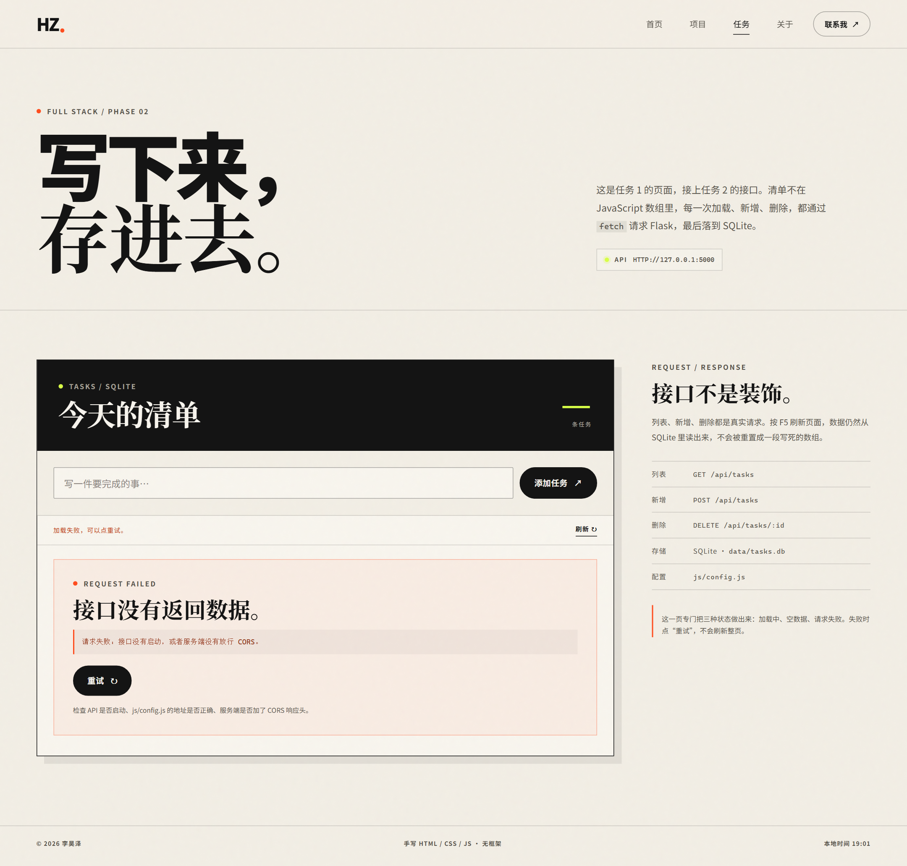
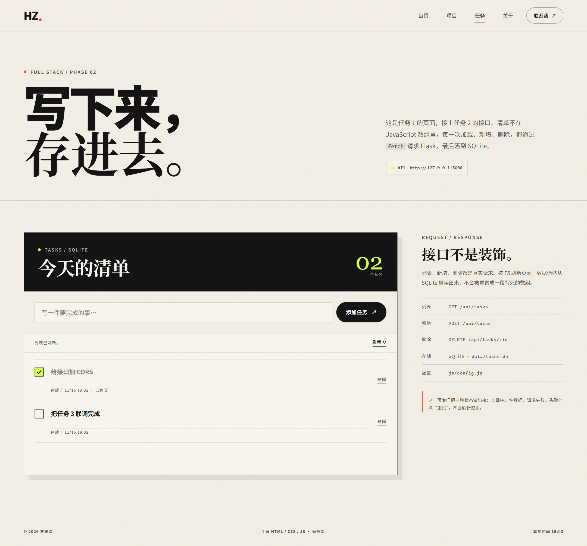

# 任务 3：前后端联调，做出增删查闭环

把任务 1 的页面和任务 2 的接口接起来，做成一个真实可操作的清单页。

- **在线页面**：<https://lihaoze-star.github.io/web-phase4-lihaoze/tasks.html>
- **前端仓库**：<https://github.com/lihaoze-star/web-phase4-lihaoze>
- **API 仓库**：<https://github.com/lihaoze-star/web-phase4-api-lihaoze>
- **公网 API**：`https://portions-smell-instruction-promising.trycloudflare.com`（Cloudflare Quick Tunnel 临时隧道）
- **接口文档**：[任务 2 接口文档](https://github.com/lihaoze-star/web-phase4-api-lihaoze/blob/main/docs/api.md)

## 这一页做了什么

- 用原生 `fetch` 调自己的 Flask 接口，列表不写死在 JS 数组里。
- 三种状态都做了：
  - **加载中**：骨架屏 + “正在读取任务…”
  - **空数据**：空状态卡片 + 引导文案
  - **请求失败**：错误原因 + “重试”按钮
- 新增、删除、勾选完成后都会重新拉取列表；按 F5 刷新页面，数据还在。
- API 地址抽到 `js/config.js`，业务代码 `js/tasks.js` 不出现后端地址。
- CORS 在 Flask 服务端解决，记录见 [cors-record.md](cors-record.md)。

## 配置

`js/config.js`：

```js
window.TASK_API_CONFIG = {
  baseUrl: isLocal
    ? "http://127.0.0.1:5000"
    : "https://portions-smell-instruction-promising.trycloudflare.com",
  timeoutMs: 8000
};
```

- 本地（`localhost` / `127.0.0.1`）自动用本地 Flask。
- GitHub Pages 上用公网 API。
- 换后端只改这一个文件；也可以在页面里注入 `window.TASK_API_BASE_URL` 覆盖。

## 三种状态截图

### 加载中



### 空数据



### 请求失败（CORS 未放行时）



### 正常列表



## 联调验证

在真实浏览器里点过一遍，而不只是 curl：

| 操作 | 结果 |
| --- | --- |
| 打开页面（空库） | 进入 empty 状态，计数 `00` |
| 输入标题并提交 | `POST /api/tasks` 201，列表自动刷新 |
| 再添加一条 | 计数 `02`，两条都来自接口 |
| 按 F5 | 仍显示两条，证明数据在 SQLite 里 |
| 勾选第一条 | `PUT /api/tasks/:id`，显示已完成 |
| 添加“临时任务：验证删除” | 计数 `03` |
| 点删除 | `DELETE /api/tasks/:id` 200，计数回到 `02` |

控制台无红色报错，页面在 1440px 下无横向滚动。

## 本地运行

```powershell
# 1. API
cd web-phase4-api-lihaoze
.venv\Scripts\python.exe app.py

# 2. 前端
cd web-phase4-lihaoze
python serve.py --port 8000
```

打开 <http://127.0.0.1:8000/tasks.html>。本地会把请求发到 `http://127.0.0.1:5000`。

## 部署方式

- **前端**：GitHub Pages，从 `web-phase4-lihaoze` 仓库的 `main` 分支根目录构建。
- **API**：当前用 Cloudflare Quick Tunnel 把本机 `127.0.0.1:5000` 映射成 HTTPS 地址：

  ```bash
  cloudflared tunnel --url http://127.0.0.1:5000
  ```

  隧道进程要保持运行；如果地址变了，只需要改 `js/config.js` 里的 `baseUrl` 并重新推送前端。

- **换成永久后端**：API 仓库里带了 `render.yaml`，在 Render 里连接仓库即可创建 Web Service；创建后把 Render 的 HTTPS 地址填进 `js/config.js`。也可以用 Railway、自己的云服务器，接口和 CORS 代码不用改。
