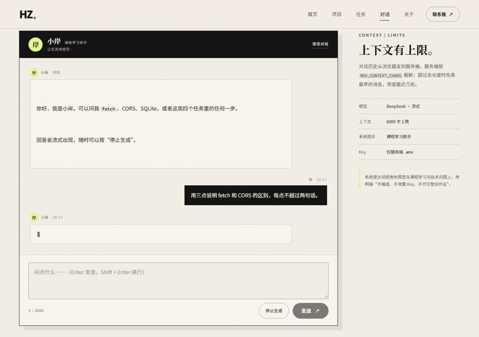
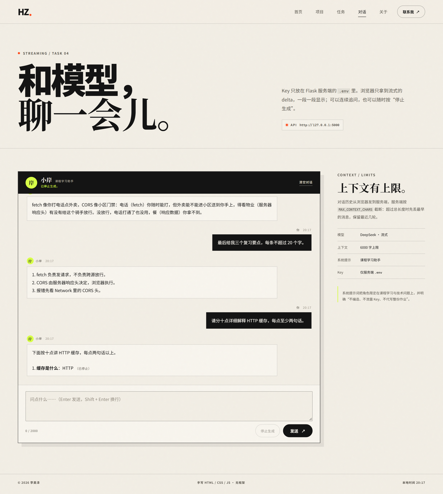
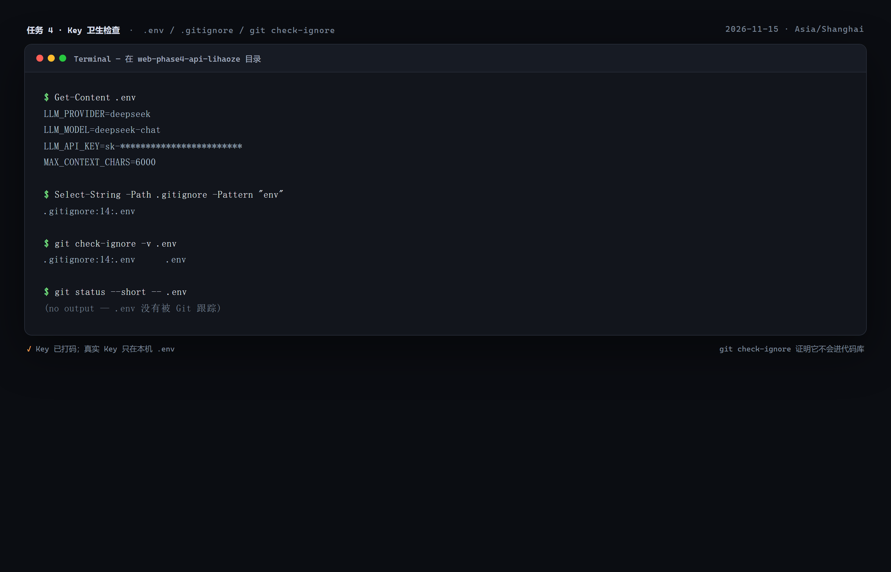

# 任务 4：接入大模型，做流式对话页

一个真的会逐字返回的对话页：前端用 `fetch` 读 SSE，Flask 在服务端转发 DeepSeek，Key 只在本机 `.env`。

- **对话页**：<https://lihaoze-star.github.io/web-phase4-lihaoze/chat.html>
- **公网 API**：`https://8943aa61effd88.app.lhr.life/api/chat`（localhost.run 临时隧道）
- **前端仓库**：<https://github.com/lihaoze-star/web-phase4-lihaoze>
- **API 仓库**：<https://github.com/lihaoze-star/web-phase4-api-lihaoze>
- **流式录屏**：[chat-streaming.gif](screenshots/chat-streaming.gif)
- **三轮对话截图**：[chat-real.png](screenshots/chat-real.png)
- **Key 未进仓库截图**：[env-proof.png](screenshots/env-proof.png)

## 架构

```text
浏览器 chat.html
  └─ POST /api/chat  { messages: [...] }
       └─ Flask 校验 / 截断上下文 / 加系统提示词
            └─ POST https://api.deepseek.com/chat/completions  stream=true
                 └─ 逐行解析 SSE，把 delta 包成 data: {"delta":"..."}
                      └─ 前端 ReadableStream 读取，逐字追加
```

- **Key 只在服务端**：`app.py` 从 `.env` 读取 `LLM_API_KEY`；`js/chat.js`、`chat.html` 里没有任何 Key。
- **流式**：不是等完整响应再一次性返回；每收到一个 `delta` 就写一个 SSE 事件。
- **停止生成**：前端 `AbortController.abort()` 中断 fetch；后端生成器在 `GeneratorExit` / 连接关闭时关闭上游 `requests` 响应。
- **三轮上下文**：前端保存 `user` / `assistant` 消息；每次请求带上历史。后端按 `MAX_CONTEXT_CHARS=6000` 从最早的消息开始丢弃，保留最近几轮。
- **系统提示词**：在 `app.py` 的 `SYSTEM_PROMPT` 中，限定为课程学习助手，不编造、不泄露 Key、不代写整份作业。
- **错误可读**：401 Key 错、402 余额不足、403 无权限、429 限流、超时、连接失败都有中文提示；不会白屏。

## 关键配置

`web-phase4-api-lihaoze/.env`（已被 `.gitignore` 忽略）：

```env
LLM_PROVIDER=deepseek
LLM_MODEL=deepseek-chat
LLM_API_KEY=sk-...
MAX_CONTEXT_CHARS=6000
```

`.env.example` 是提交到仓库的空模板，不含真实 Key。

## 验证

### 流式输出

44 帧录屏，画面里能看到回答一段段出现，而不是一次性刷屏：



### 连续三轮

截图里可以看到三轮问答；第三轮回答引用了前两轮的 fetch / CORS 上下文：



### 停止生成

在第四轮长回答生成到一半时点击“停止生成”：

- 状态变为「已停止生成」
- 已经生成的部分保留，并标记「已停止」
- 停止按钮回到禁用，发送按钮恢复

### Key 没进仓库

`.env` 真实 Key 打码；`git check-ignore -v .env` 指向 `.gitignore:14:.env`；`git status --short -- .env` 没有任何输出：



### 错误处理

`tests/test_api.py` 覆盖了：

- 没有 Key → 500 JSON：`服务端没有配置 LLM_API_KEY...`
- 上游 401 → SSE 中文提示：`API Key 无效或已过期...`
- 上游 429 → SSE 中文提示：`请求太频繁（429）...`
- 请求超时 → SSE 中文提示：`模型响应超时...`

后端共 **27 个测试**通过。

## 本地运行

```powershell
# API（需要能访问 api.deepseek.com）
cd web-phase4-api-lihaoze
.venv\Scripts\python.exe app.py

# 前端
cd web-phase4-lihaoze
python serve.py --port 8000
```

打开 <http://127.0.0.1:8000/chat.html>。

## 部署

- 前端：GitHub Pages，`chat.html` 随仓库自动发布。
- API：当前用 localhost.run 隧道；长期在线可按 API 仓库的 `render.yaml` 部署到 Render，把 Render 的 HTTPS 地址填到 `js/config.js` 的 `baseUrl`。
- Render 上需要在 Environment 里补 `LLM_API_KEY`，不要把 Key 写进 `render.yaml`。
