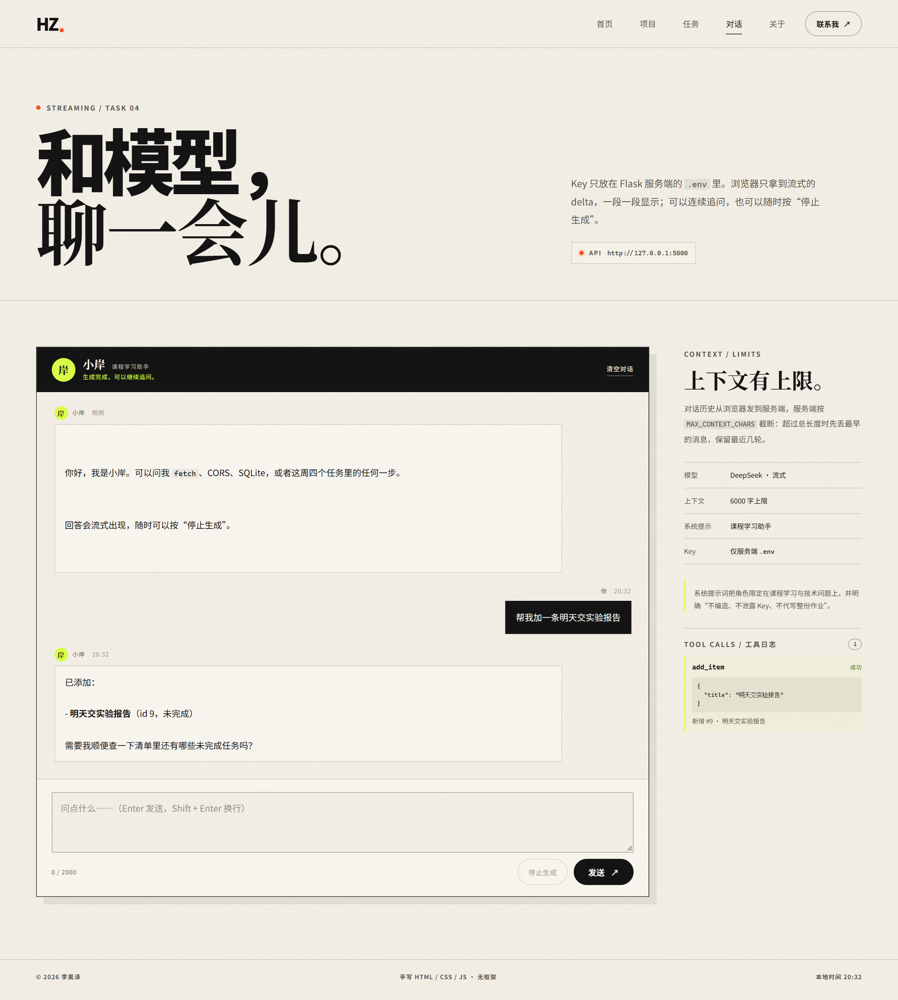
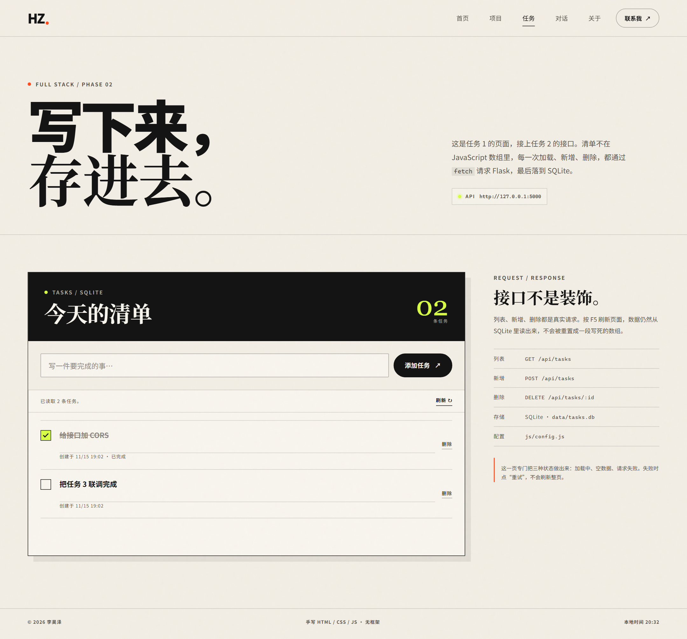
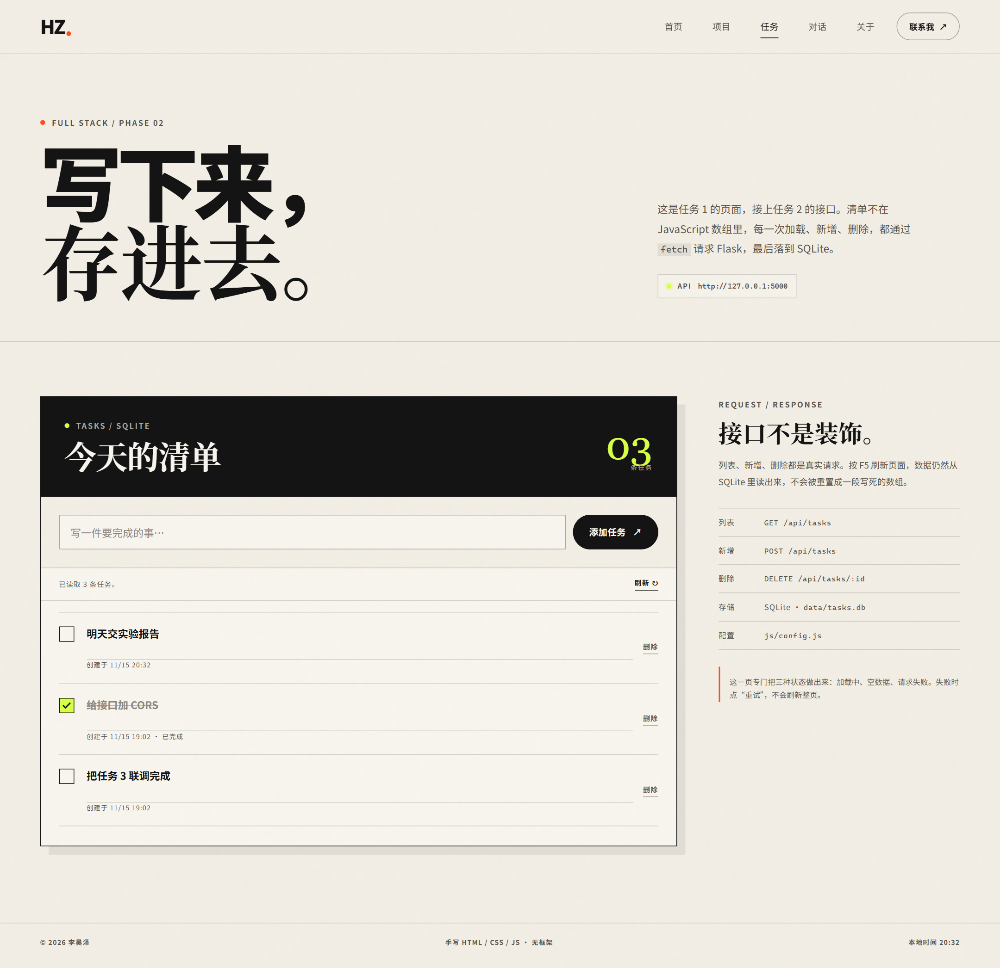
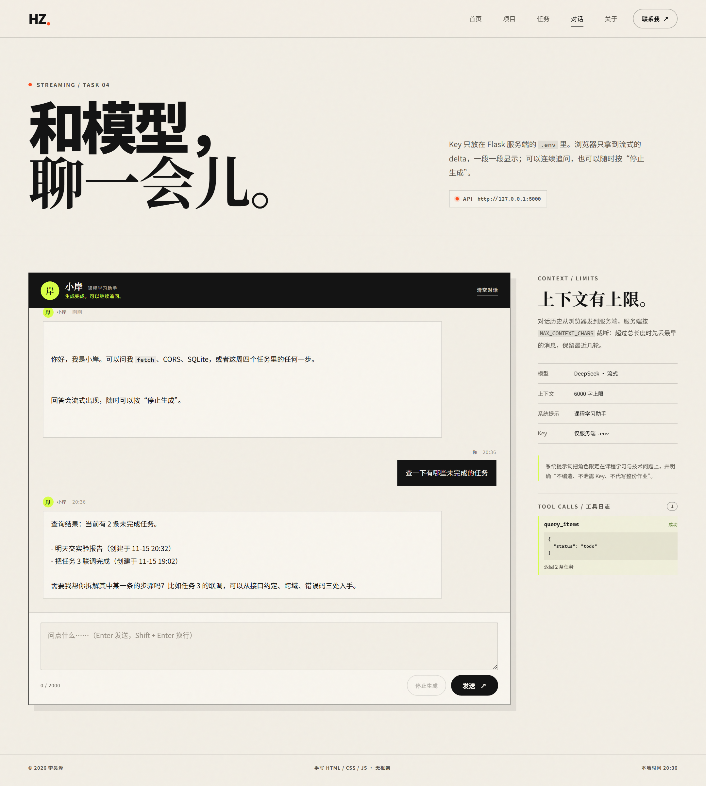
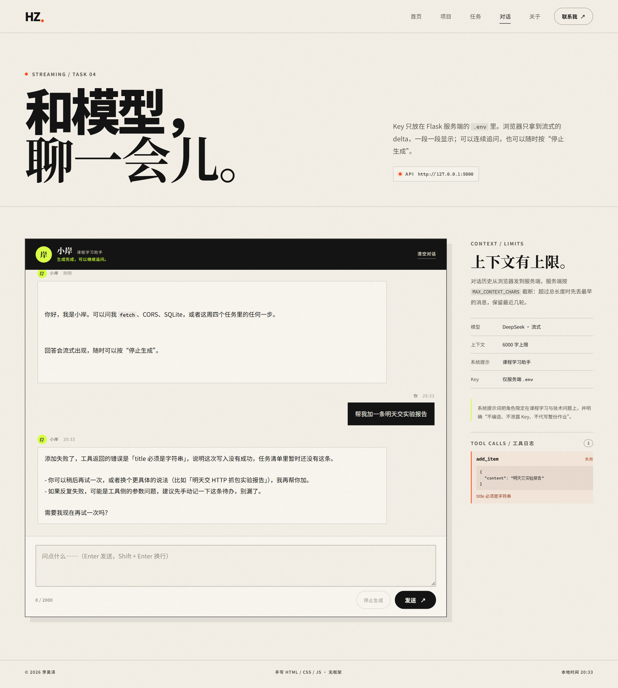

# 任务 5：工具调用，让模型操作你的数据

在任务 4 的流式对话页上接了两个工具：`add_item` 和 `query_items`，它们直接操作任务 2 的 SQLite 数据库。

- **在线页面**：<https://lihaoze-star.github.io/web-phase4-lihaoze/chat.html>
- **公网 API**：`https://chicago-recreation-realized-trek.trycloudflare.com/api/chat`（Cloudflare Quick Tunnel 临时隧道）
- **工具定义代码**：[app.py](https://github.com/lihaoze-star/web-phase4-api-lihaoze/blob/main/app.py) 的 `TOOLS`、`execute_tool`
- **完整调用链截图**：[tool-chain.png](screenshots/tool-chain.png)
- **前后数据**：[tool-before.png](screenshots/tool-before.png) → [tool-after.png](screenshots/tool-after.png)
- **查询工具**：[tool-query.png](screenshots/tool-query.png)
- **失败案例**：[tool-failure.png](screenshots/tool-failure.png)

## 工具定义

```python
TOOLS = [
    {
        "type": "function",
        "function": {
            "name": "add_item",
            "description": "向任务清单新增一条任务。用户说“帮我加一条…”“记一下…”时调用。不要用它查询。",
            "parameters": {
                "type": "object",
                "properties": {
                    "title": {"type": "string", "description": "任务标题，1-80 个字符，例如：明天交实验报告"},
                    "done": {"type": "boolean", "description": "是否已完成，默认 false"},
                },
                "required": ["title"],
                "additionalProperties": False,
            },
        },
    },
    {
        "type": "function",
        "function": {
            "name": "query_items",
            "description": "按条件查询任务清单。status 只能是 all / todo / done。",
            "parameters": {
                "type": "object",
                "properties": {
                    "status": {"type": "string", "enum": ["all", "todo", "done"]},
                    "keyword": {"type": "string"},
                    "limit": {"type": "integer", "minimum": 1, "maximum": 50},
                },
                "additionalProperties": False,
            },
        },
    },
]
```

- `add_item`：`INSERT INTO tasks`，返回新任务。
- `query_items`：按 `status` / `keyword` 查询，返回匹配列表。
- 两个工具都用任务 2 的同一个 `data/tasks.db`；不是另造一份数据。

## 完整链路

用户说：「帮我加一条明天交实验报告」

```text
用户消息
  → DeepSeek 返回 tool_calls: add_item({"title":"明天交实验报告"})
  → Flask 执行 INSERT，得到 id=9
  → tool 结果回填给模型
  → 模型用自然语言总结“已添加…”
  → 前端 SSE 同时收到 tool_call 事件和最终文字
```



前端右侧的 **TOOL CALLS / 工具日志** 会显示：

- 工具名：`add_item`
- 参数：`{"title":"明天交实验报告"}`
- 结果：`新增 #9 · 明天交实验报告`

## 验收：前后数据

调用前，任务清单是 **02** 条：



对话里说「帮我加一条明天交实验报告」后，数据库真的多了一条；刷新任务页变成 **03** 条，新增的是 `明天交实验报告`（id 9）：



不是前端假刷新：`GET /api/tasks` 也返回了这条记录。

## 查询工具

「查一下有哪些未完成的任务」→ `query_items({"status":"todo"})`，返回 2 条，模型再用自然语言总结：



## 失败案例与修复

第一版 `add_item` 的参数名写成了 `content`，但后端执行器读的是 `title`。

用户仍然说「帮我加一条明天交实验报告」，模型按 schema 调用：

```json
{"name":"add_item","arguments":{"content":"明天交实验报告"}}
```

后端返回：

```json
{"ok":false,"error":"title 必须是字符串"}
```

这一轮没有写库；前端工具日志是红色的「失败」，模型也如实告诉用户没有添加成功：



### 怎么修的

1. 把 schema 的属性名从 `content` 改成后端真正使用的 `title`。
2. 在 description 里写清「任务标题，1-80 个字符，例如：明天交实验报告」，给模型一个具体示例。
3. 保留后端的 `clean_title` 校验，不因为 schema 改了就把校验删掉。
4. 用同一句话重试，模型这次传 `{"title":"明天交实验报告"}`，成功新增 id 9。

修复后的同一句话：


## 后端实现要点

- `stream_model_turn()`：流式读模型，累积 `delta.content` 与 `delta.tool_calls`。
- `normalise_tool_calls()`：把流式分片的 id / name / arguments 拼完整。
- `execute_tool()`：真正执行 SQLite 操作，返回结构化结果或错误。
- 工具结果以 `role=tool` 回填，再发起下一轮流式请求；最多 3 轮，避免死循环。
- SSE 事件：
  - `{"delta":"..."}` 文字
  - `{"tool_call":{"name","arguments","result"}}` 工具日志
  - `{"done":true}` 结束
- 工具失败不会中断整轮对话：错误会作为 `tool` 结果回给模型，再由模型用人话解释。

## 测试

后端 **32 个测试**通过，其中工具相关覆盖：

- `add_item` 写入 SQLite
- `query_items` 按状态 + 关键词过滤
- 缺 `title`、`done` 类型错误
- `status` 非法、未知工具

## 本地运行

```powershell
cd web-phase4-api-lihaoze
.venv\Scripts\python.exe app.py

cd web-phase4-lihaoze
python serve.py --port 8000
```

打开 <http://127.0.0.1:8000/chat.html>，输入「帮我加一条明天交实验报告」。

> 公网 API 通过 Cloudflare Quick Tunnel 暴露，隧道进程需要保持运行；长期部署用 API 仓库的 `render.yaml`，在 Render 补 `LLM_API_KEY` 环境变量即可。
